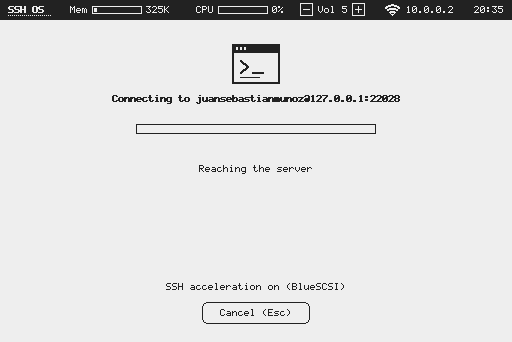
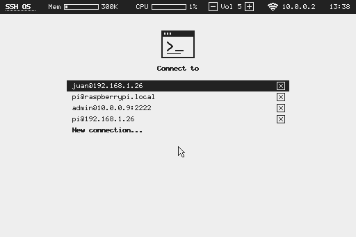
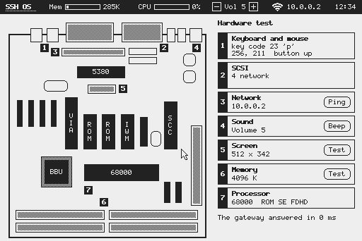
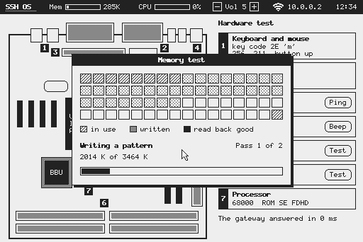

# SSH OS

A single purpose operating system for the Macintosh SE, written from scratch, whose main job
is to be an SSH terminal. It starts from a BlueSCSI in a few seconds, joins
your WiFi, and logs in to other computers by itself: a real SSH client on an
8 MHz 68000, with nothing in between. There is no Mac OS underneath. Apple's
ROM is used for one thing only, reading the kernel off the disk at start-up;
after that it is never called again.

**Status.** SSH OS runs on a real Macintosh SE (FDHD ROM, 4 MB) with a
BlueSCSI: it starts from the card, joins the WiFi and logs in over SSH. It
is developed and tested in the Snow emulator and checked on the real
machine. What it does not do yet is in the [notes](docs/NOTES.md#not-done).

**To try it** you need no tools: take the zip from the
[releases page](https://github.com/naruse/SSH-OS/releases), copy its three
files to an SD card and put the card in the BlueSCSI, as below.

## Install

Each release on the [releases page](https://github.com/naruse/SSH-OS/releases)
is one zip, `SSH-OS-VERSION.zip`, made by `make release`. In it:

| File | What it is |
|---|---|
| `HD0_512 SSH OS boot.hda` | SSH OS itself; the SE starts from this |
| `HD1_512 SSH OS.hda` | An empty SSH OS disk, where it keeps your WiFi, the servers you connect to and its own key |
| `NE4.hda` | An empty file: it switches on the BlueSCSI's network adapter |
| `firmware/` | A BlueSCSI firmware that makes SSH much faster, [see below](#faster-ssh-the-bluescsi-firmware) |
| `INSTALL.txt` | These steps, and what to check if it does not start |

1. Format an SD card as FAT32 or exFAT. Use a card of its own; your Mac OS
   card stays as it is.
2. Copy the three `.hda` files to the top of the card, names unchanged.
3. Put the card in the BlueSCSI and switch the SE on.
4. Click the fan at the right of the bar, click your WiFi network and type
   its password.
5. Click SSH, then New connection, and type `user@server`.
6. Optional, and worth it: put the firmware from the release on the
   BlueSCSI, [as below](#faster-ssh-the-bluescsi-firmware). Connecting
   takes about a minute without it.

The release is built from `config.release.txt`, which holds nothing but
"ask the network for an address": no key, no server, no WiFi of anyone's.
Nothing in it is Apple's. To build it yourself instead, see
[Building and testing](docs/BUILDING.md).

## Faster SSH: the BlueSCSI firmware

SSH's arithmetic is heavy for an 8 MHz 68000: with the BlueSCSI's own
firmware the SE does it all itself, and connecting takes about a minute.
The release also holds a BlueSCSI firmware with one addition: SSH OS can
hand that arithmetic, and the encryption of a session's packets, to the
BlueSCSI's much faster processor. Connecting then takes a small part of
that time. SSH OS finds out by itself which firmware is there, and says
"SSH acceleration on (BlueSCSI)" while it connects.

It is for a BlueSCSI v2 with a **Pico W** (not the Pico 2 W). Everything
else in the firmware is as BlueSCSI makes it.

| File in the release | What it is for |
|---|---|
| `firmware/BlueSCSI_Pico_DaynaPORT_SSHOS.uf2` | Putting it on over USB |
| `firmware/BlueSCSI_Pico_DaynaPORT_SSHOS.bin` | Updating from the SD card afterwards |

Over USB, which works with any firmware that is on there now:

1. Switch the SE off and unplug the BlueSCSI's ribbon cable and power
   plug (or take the Pico out of its socket).
2. Hold the white BOOTSEL button on the Pico and plug its USB port into a
   computer. A drive called `RPI-RP2` appears.
3. Copy the `.uf2` file onto that drive. It disappears by itself when done.

Later versions can go on from the card: copy the `.bin` file to the top of
the SD card and switch on; the BlueSCSI takes it in and removes the file.
(That is how BlueSCSI's firmware describes it; we have only used USB so
far.) To go back, put BlueSCSI's own release on the same way.

The firmware is BlueSCSI's, under its licence (GPL 3), with our addition:
[the source](https://github.com/naruse/BlueSCSI-v2/tree/sshos), and what the addition does in
[firmware/](firmware/README.md).

## Keys

| Key | What it does |
|---|---|
| Command-Q, or Control-] | Ends the SSH session and returns to the home screen |
| Esc | Stops a connection while it is being made |
| Command-Up, Command-Down | Page Up, Page Down: scroll back in programs that keep a history |
| Command-Left, Command-Right | Home, End |

The SE's own keyboard has no Page Up, Page Down, Home or End, which is why
Command with an arrow stands in for them. More in [Using it](docs/USING.md).

## What it does

| | |
|---|---|
| Start-up | The SE's ROM loads a 3 KB loader from the BlueSCSI (or a 1 KB boot block from a floppy), which draws the start-up picture and loads the kernel. A row of small pictures fills in as each part comes up |
| Kernel | Interrupts, 60 Hz clock, crash screen, serial log on the modem port |
| Input | Keyboard and mouse (ADB), our own driver; mouse speed in Settings |
| Disk | SCSI driver: scan the bus, read and write blocks |
| File system | The SSH OS disk: a FAT16 volume for settings, trusted SSH servers and past connections |
| Network | The BlueSCSI's WiFi adapter over SCSI; ARP, IP, ping, UDP, DHCP, DNS, TCP |
| SSH | Curve25519, Ed25519, ChaCha20-Poly1305, all in plain C on the 68000, or handed to the BlueSCSI where its firmware can; log-in by key or password |
| Terminal | An xterm-style terminal, 85 x 32 characters, so full-screen programs work: editors, `top`, `tmux`, text interfaces |
| Home screen | A bar (memory, processor load, volume, network, clock), the SSH OS menu, and icons for SSH, the hardware test and Settings; mouse or keyboard |
| Hardware test | The SE's logic board with a number on each part, and a field for each to see and try it: keyboard and mouse, SCSI, network, sound, screen, memory |

## A look at it

## More

- [Using it](docs/USING.md): the home screen, SSH and its keys, the
  terminal, typing accented letters, the settings file.
- [Building and testing](docs/BUILDING.md): what you need, the build, the
  emulator, the tests and how they run on GitHub.
- [Notes](docs/NOTES.md): how long things take, other machines, what is not
  done, where things are in the source.

## Licence

MIT, see `LICENSE`.
