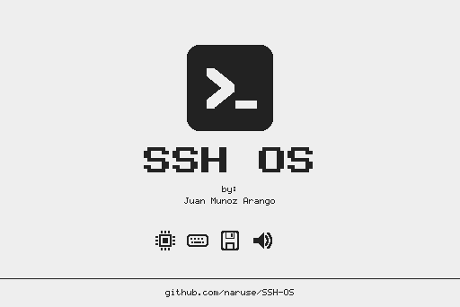
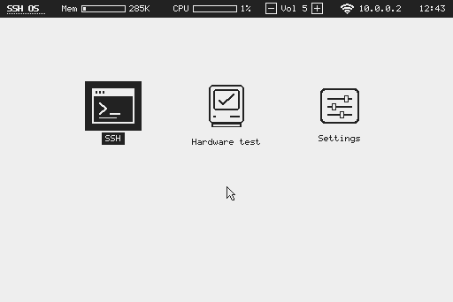
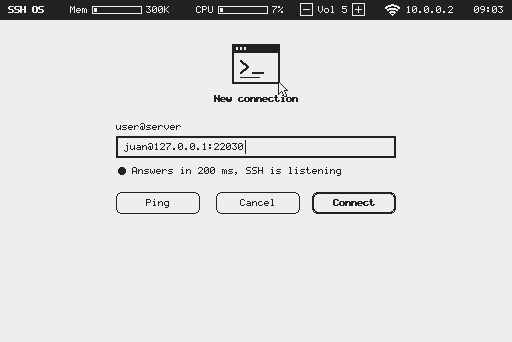
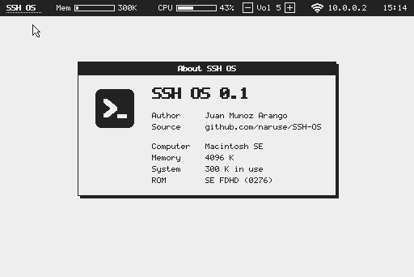
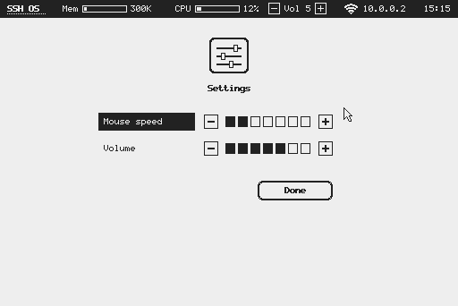
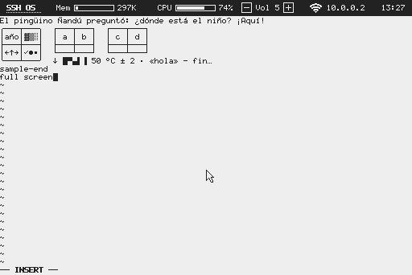

# SSH OS

An operating system for the Macintosh SE, written from scratch, whose main job
is to be an SSH terminal. It starts from a BlueSCSI in a few seconds, joins
your WiFi, and logs in to other computers by itself: a real SSH client on an
8 MHz 68000, with nothing in between. There is no Mac OS underneath. Apple's
ROM is used for one thing only, reading the kernel off the disk at start-up;
after that it is never called again.





**Status.** SSH OS runs on a real Macintosh SE (FDHD ROM, 4 MB) with a
BlueSCSI: it starts from the card, shows the home screen and logs in over
SSH. The newest parts (the terminal for full-screen programs, Settings, the
Ping button, the start-up screen, the hardware test's board) have so far only run in
the Snow emulator. See "Not done or not verified" at the end.

## What it does

| | |
|---|---|
| Start-up | The SE's ROM loads a 3 KB loader from the BlueSCSI (or a 1 KB boot block from a floppy), which draws the start-up picture and loads the kernel. A row of small pictures fills in as each part comes up |
| Kernel | Interrupts, 60 Hz clock, crash screen, serial log on the modem port |
| Input | Keyboard and mouse (ADB), our own driver; mouse speed in Settings |
| Disk | SCSI driver: scan the bus, read and write blocks |
| File system | The SSH OS disk: a FAT16 volume for settings, trusted SSH servers and past connections |
| Network | The BlueSCSI's WiFi adapter over SCSI; ARP, IP, ping, UDP, DHCP, DNS, TCP |
| SSH | Curve25519, Ed25519, ChaCha20-Poly1305, all in plain C on the 68000; log-in by key or password |
| Terminal | An xterm-style terminal, 85 x 32 characters, so full-screen programs work: editors, `top`, `tmux`, text interfaces |
| Home screen | A bar (memory, processor load, volume, network, clock), the SSH OS menu, and icons for SSH, the hardware test and Settings; mouse or keyboard |
| Hardware test | The SE's logic board with a number on each part, and a field for each to see and try it: keyboard and mouse, SCSI, network, sound, screen, memory |

## What you need

To run it:

- A Macintosh SE. It is developed on an SE FDHD with 4 MB.
- A [BlueSCSI v2](https://bluescsi.com) with the Pico W (the WiFi model) and
  an SD card. The BlueSCSI is both the disk SSH OS starts from and its
  network adapter.
- An SSH server to log in to: any OpenSSH from 2014 or later.

To build it (macOS or Linux):

- `m68k-elf-gcc` and `m68k-elf-binutils`. With Homebrew:

  ```bash
  brew install m68k-elf-binutils m68k-elf-gcc
  ```

- Python 3 and `make`.

Nothing else: no Apple software, no libraries. The ROM is not part of this
repository and is not needed to build; only the emulator needs one (see
"Emulator and tests").

## Build

```bash
make
```

That writes, in `build/`:

| File | What |
|---|---|
| `sshos-boot.hda` | The hard disk image the SE starts from on a BlueSCSI |
| `sshos-800k.dsk`, `sshos-1440k.dsk` | The same system as raw floppy images, for a floppy emulator or a real disk |

Your own settings are built in. Before `make`, copy `config.example.txt` to
`config.txt` and edit it; without one the example is used (DHCP, start at the
home screen), which is fine for a first try. `config.txt` can hold secrets
(an SSH key, a WiFi password): it is in `.gitignore`, and so are the images
built from it. Keep them private.

How it is put together: `boot/boot.S` is the loader, in assembly; everything
in `kernel/` is linked into one kernel image that the loader reads to address
`0x40000`; `tools/mkbootdisk.py` lays the loader and the kernel out on the
disk image behind the small map the ROM looks for. The font, the icons and
the big name are text art (`fonts/`, `tools/mkbanner.py`) turned into tables
at build time.

## Put it on the BlueSCSI's card

Format the SD card as exFAT (or FAT32) and copy three files into its top
folder:

| File on the card | What |
|---|---|
| `HD0_512 SSH OS boot.hda` | A copy of `build/sshos-boot.hda`: SSH OS itself, at SCSI ID 0 |
| `HD1_512 SSH OS.hda` | The SSH OS disk, where settings and connections are kept (SCSI ID 1). Make it once, see below |
| `NE4.hda` | An empty file: it switches on the BlueSCSI's network adapter at SCSI ID 4 |

```bash
cp build/sshos-boot.hda "/Volumes/CARD/HD0_512 SSH OS boot.hda"
```

```bash
python3 tools/sshosdisk.py make "/Volumes/CARD/HD1_512 SSH OS.hda" 16
```

```bash
touch /Volumes/CARD/NE4.hda
```

Only the part of each name before the first space matters to the BlueSCSI.
Put the card in, switch the SE on. After a new build, replace the `HD0` file
only: your settings live in the `HD1` file and stay as they are.

## First start

The start-up screen shows for a few seconds, then the home screen.

1. **WiFi.** Click the fan icon on the bar (or press W). The panel lists the
   networks in range; click yours and type its password. It is remembered on
   the SSH OS disk. (A `bluescsi.ini` on the card with the BlueSCSI's own
   WiFi settings works too.)
2. **SSH.** Click the SSH icon, type `user@server`, press Return. The first
   time, the SE shows the fingerprint of the server's key and asks whether to
   trust it; then it asks for the password. Connecting takes the SE about a
   minute, see "How long connecting takes".
3. Command-Q or Control-] ends a session and returns to the home screen.

## The home screen

| | Mouse | Keyboard |
|---|---|---|
| Open SSH, the hardware test or Settings | click its icon | Left/Right, then Return |
| SSH OS menu | click SSH OS in the bar | J, then Up/Down and Return |
| Network details, other WiFi networks | click the fan icon | W |
| Volume down and up | click the - and + on either side of Vol | - and + |
| Close a menu, panel or window | click elsewhere | Esc or any key |

The bar stays at the top in every program, and so does the mouse pointer:
the menu, the panels and the volume can be used from inside an SSH session
too. The SSH OS menu has About, Home, OSConsole (the command line; `help`
lists every command), Restart and Shut down.

**SSH** opens on the list of connections used before, newest first, with
"New connection" under them. "New connection" has a Ping button (or Tab): it says whether the
server answers and SSH is listening. Connect asks the same first, so a dead
server is reported in about 4 seconds, before the slow key work.
Up/Down and Return or a click connect; Delete forgets one.

In the New connection field a click or the Left and Right arrows move the
caret. While it connects there is a Cancel button; Esc does the same, at any
point, the slow key steps included.







**Settings** has the mouse speed (seven steps, from half speed to six times)
and the volume. Both are kept on the SSH OS disk.


**Hardware test** draws the SE's logic board as it lies in the case, after a
photograph of one: the sockets of the back panel along the top, the memory
along the bottom. Each numbered part has a field beside it with what it
reports now (the last key, where the mouse is, what answers on the SCSI
bus) and, where there is something to try, a button: Ping, Beep, Test. The
keys P, B, S and M do the same; + and - change the volume; Esc goes back.


The memory test shows the machine's memory as 64 squares. Each fills in as
it is written and turns black as it reads back good, twice over with
opposite patterns; a square that reads back wrong keeps a cross. The
hatched squares hold SSH OS itself, its stack and the screen, and are left
alone. It takes about 15 seconds; Esc stops it.

The time comes from the Mac's own battery-backed clock, as the ROM read it at
start-up; if that battery is flat it will be wrong.

## The SSH OS disk

What is changed on the SE is kept on a hard disk of its own, so it is still
there after a restart:

| File | What |
|---|---|
| `SETTINGS.TXT` | Settings changed on the SE: `set NAME VALUE` in the OSConsole, the volume, the WiFi network joined from the panel (with its password, as plain text). They win over the ones built into the boot disk. |
| `HOSTS.TXT` | SSH servers whose key you accepted. The question comes once per server. |
| `RECENT.TXT` | The last eight SSH connections. The SSH icon opens on this list: Up/Down and Return or a click connect, Delete forgets one, "New connection" asks for another. |

Without an SSH OS disk everything works as before and lasts until restart.

To make one, give the machine a blank disk image (on the BlueSCSI's card,
for example a file of zeros named `HD1_512 SSH OS.hda` for SCSI ID 1) and in
the OSConsole type `scsi` to see its ID, then `format ID`. Or make it ready
on your computer:

```bash
python3 tools/sshosdisk.py make "HD1_512 SSH OS.hda" 16
```

The disk is a FAT16 volume named SSH OS, so the image also opens on a modern
Mac (`hdiutil attach -imagekey diskimage-class=CRawDiskImage FILE`) and the
files can be read and edited there;
`tools/sshosdisk.py` lists, reads and writes them without mounting, and
`check` goes through the whole volume. Files are in one folder, have short
names (8 characters, a dot, 3) and are read and written whole. In the
OSConsole: `disk`, `ls`, `cat NAME`, `rm NAME`.

Two rules protect your disks. SSH OS writes only to a volume named SSH OS,
and `format` refuses any disk that is not blank or an SSH OS disk already, so
a disk with a Mac system on it is never touched. And a file is replaced by
writing the new one to free space and switching over in a single block, so
switching the machine off mid-write leaves the old file or the new one.

`disk = 1` in `config.txt` names the SCSI ID and saves the second or two it
takes to look at every ID at start-up (that happens after the home screen is
up).

`start = shell` in `config.txt` starts at the command line instead; `ssh`
and `term` start those programs.

## SSH

In the OSConsole the same client is the command `ssh me@192.168.1.10`, or
just `ssh` with the address in the setting `ssh`. The SE talks to the server
directly: standard SSH, as any current OpenSSH server speaks it.

**Logging in with a key** (no password to type). Make a key just for the SE,
on your computer:

```bash
ssh-keygen -t ed25519 -N '' -C 'Macintosh SE' -f se_key
```

```bash
python3 tools/sshkey.py se_key
```

The second command prints an `ssh_key = ...` line for `config.txt`. The line
in `se_key.pub` goes into `~/.ssh/authorized_keys` on each server. The key
sits unprotected in the boot image, so treat that image and `config.txt`
like the key itself, and delete the key from `authorized_keys` if the card
gets lost.

**Logging in with a password.** Without `ssh_key`, or if the server does not
accept the key, the SE asks for the password in a small window (a dot for
each letter).

**Is it the right server?** On the first connection the SE shows the
fingerprint of the server's key and asks. The answer is kept on the SSH OS
disk (`HOSTS.TXT`), so later connections do not ask, and a server that
suddenly shows a different key is refused.

**What it needs from the server:** an Ed25519 host key, the key exchange
`curve25519-sha256` and the cipher `chacha20-poly1305@openssh.com`. OpenSSH
has had all three since version 6.5 (2014). Servers limited to other choices
are refused with a message saying which is missing.

**The terminal** (`kernel/vt.c`) tells the server it is `xterm-256color` and
understands what xterm does, as far as a black-and-white screen can show it:
cursor movement, erasing, inserting and deleting, scrolling regions, the
second screen that full-screen programs switch to, bold, underline and
inverse, UTF-8, and the questions programs ask a terminal. There are no
colours: a coloured background is shown as inverse, coloured text as plain.
The font has Western European accents, line drawing, blocks and arrows;
anything else becomes the nearest of those, or `?`. The screen is 85 columns
by 32 lines. `ssh_term` in the settings changes what it calls itself.



## Typing accented letters

Option works as on a Mac with the US layout, in the OSConsole, in `ssh`
and in `term`:

| Keys | Result |
|---|---|
| Option-e, then a vowel | á é í ó ú |
| Option-n, then n | ñ |
| Option-u, then a vowel | ä ë ï ö ü |
| Option-`, then a vowel | à è ì ò ù |
| Option-i, then a vowel | â ê î ô û |
| Shift-Option-/ and Option-1 | ¿ ¡ |
| Option-c | ç |
| Option-\ and Shift-Option-\ | « » |

Capitals work the same way (Option-n, then N). Also there: ß å ø æ £ ¢ ¥ § ¶
© ® ° ± · µ ÷ ª º ¬ • … —, on their Mac keys.

In `ssh` and `term`, Option with any other key is the Meta key, so Option-b
and Option-f still move by a word; pressing Esc first works for every key.
In `term` only, `option = meta` in `config.txt` makes Option always Meta.

## Settings file

`config.example.txt` explains every setting. The ones most used:

| Setting | What |
|---|---|
| `network` | `dhcp`, or four numbers: address, mask, gateway, name server |
| `ssh` | Where `ssh` without arguments logs in: `user@host` or `user@host:port` |
| `ssh_key` | The SE's own key, from `tools/sshkey.py` |
| `ssh_term` | What the terminal calls itself; `xterm-256color` unless set |
| `start` | What runs at start-up: `desk` (the home screen), `shell`, `ssh` |
| `disk` | The SCSI ID of the SSH OS disk, which saves looking at every ID |
| `mouse`, `volume` | 1 to 7 and 0 to 7; Settings and the bar change them |

Settings changed on the SE (`set NAME VALUE` in the OSConsole, Settings, the
WiFi panel) are written to the SSH OS disk and win over the built-in ones.

## Emulator and tests

Everything is developed in the [Snow](https://snowemu.com) emulator, which
runs the SE's real ROM. For that you need two things that are not in this
repository:

- A ROM image of your own Macintosh SE FDHD, in the project folder as
  `B306E171 - Mac SE FDHD.ROM` (or `make ROM=path ...`). It is Apple's code
  and may not be shared.
- Snow: the app in `emu/Snow.app` for `make run` and `make demo`, and its
  source in `~/.cache/juanos/snow-src` for the tests' headless runner, which
  `make tools` builds from `tools/snowrun/main.rs` (needs Rust).

```bash
make demo
```

opens Snow with the emulated SE at its home screen. The SSH icon then logs
in to the computer you are sitting at: for that the demo starts an OpenSSH
server (your computer's own `sshd`, without special rights) that listens on
that computer only and accepts one throw-away key built into the demo disk.
It stops when Snow closes.

```bash
make test-all
```

| Target | What it checks |
|---|---|
| `test`, `test-crash` | Boot, typing in the OSConsole (accents included), the crash screen |
| `test-disk` | The SSH OS disk in the emulated SE: format, save, restart, read back; SSH asks about a server once only |
| `test-fs-host` | The file system on this computer against a second implementation: every size, a full disk, power cuts while writing, disks that are not ours |
| `test-scsi` | Bus scan, block read, write and read back, read speed |
| `test-net`, `test-tcp` | Ping; a 256 KB download and a 32 KB echo with every byte checked |
| `test-term` | The real helper and a shell, through the emulator: output, accents shown and typed, Meta |
| `test-net-host` | The network code on this computer against a simulated network: DHCP, DNS, TCP with lost, damaged and reordered packets |
| `test-misc-host`, `test-helper` | SHA-256, settings parser, every Option combination of the keyboard, the WiFi commands against a stand-in, the helper's screen model and encoder |
| `test-desk` | The home screen in the emulator: SSH OS menu, About, network panel, hardware test and back, by keys and mouse |
| `test-wifi` | The network panel's list and joining, with a made-up WiFi adapter built in |
| `test-crypto-host` | X25519, ChaCha20, SHA-512, Poly1305 and Ed25519 against plain Python arithmetic and the published values |
| `test-ssh-host` | The SSH client, built for this computer, against its own OpenSSH server: key and password log-in, unknown and changed server keys, 600 KB of output across several changes of keys, forged and damaged packets |
| `test-ssh` | The same client in the emulated SE: log-in with a key, a shell, accents typed and shown |

| `test-hdboot` | Starting from the hard disk image alone, as on the BlueSCSI |
| `test-vt-host` | The terminal, built for this computer: stated cases, and 300 random streams of orders compared with a second, separately written terminal |

## How long connecting takes

The 68000 does all of SSH's arithmetic itself, in plain C. `make bench`
times the pieces on the emulated SE:

| | |
|---|---|
| Key exchange (X25519), two of these | 12.4 seconds each |
| Checking the server's signature (Ed25519) | 20.7 seconds |
| Signing with the SE's key (Ed25519) | 16.0 seconds |
| ChaCha20 | 18.8 KB per second |
| Poly1305 | 8.2 KB per second |

So logging in with a key takes 63 seconds (measured by `make test-ssh`), with
a password about 46, and the first of those steps is done before the server
is contacted. Afterwards output arrives at up to about 5 KB per second, since
every byte passes through both ChaCha20 and Poly1305; typing feels immediate.
Most servers close a connection that has not logged in within two minutes,
so there is room, but not much.

The plan is to hand these calculations to the BlueSCSI's own processor,
which does each in a few thousandths of a second; connecting would then take
a second or two. The SE's side is ready for that: the four slow calculations
are four function calls. The BlueSCSI's side, a change to its firmware, is
not written.

## Other machines

**Macintosh SE/30: not as it is.** The kernel's 68000 code would run on the
SE/30's 68030, and the loader and the screen (same size, found through the
ROM) would work, but the chips sit at different addresses and some behave
differently: the VIAs, the serial chip, the SCSI chip's fast transfer mode,
sound, and the frames the processor leaves on the stack when something goes
wrong. It is a port of the lowest layer (`kernel/hw.h`, `scsi.c`, `via.c`,
`trap.c`, `snd.c`), not a rewrite, and has not been started. An SE/30 would
do the SSH arithmetic several times faster.

**Macintosh Plus and Classic:** not tried. The Plus has no ADB, so its
keyboard and mouse would need their own driver.

## Not done or not verified

- On the real SE: starting from the BlueSCSI, the home screen and an SSH
  log-in work. Everything added after that first run has only been tried in
  the emulator: the terminal for full-screen programs, Settings and the mouse
  speed, the Ping button, the start-up screen, the hardware test's board and
  the memory map.
- SSH:
  - Connecting takes about a minute (see above).
  - Random numbers, which SSH's safety rests on, are gathered from the
    timing of keys, mouse and network packets (`kernel/rng.c`). That is
    weaker than a modern computer's source, most of all right after start-up.
    The BlueSCSI's processor has a real source and should supply them.
  - The question-and-answer log-in some servers use instead of plain
    passwords is not there.
  - One choice of each method (see "SSH" above); no RSA or ECDSA server
    keys, no compression, no port forwarding, no file copy.
  - While the server changes keys in mid-session (OpenSSH: after 1 GB or
    when set to) the screen stands still for about 45 seconds.
  - The terminal has no colours, no mouse reporting and a fixed size; wide
    characters (Chinese, Japanese, Korean, emoji) show as `?`.
  - Ping is a connection to the SSH port that is dropped at once;
    a careful server may log it. Its time is measured in sixtieths of a
    second, so small figures are rough.
- SSH OS disk:
  - One folder, short names, whole files; nothing bigger than settings uses
    it yet. The WiFi password is stored as plain text.
  - A power cut while writing can leave space marked as used that no file
    has (`tools/sshosdisk.py check` reports it; a disk checker frees it).
- Home screen:
  - The WiFi name, signal, list and joining use commands that the BlueSCSI
    firmware adds to its network adapter (`kernel/wifi.c`, written from the
    firmware's source). Snow's adapter has none of them, so in the emulator
    they only run against a made-up adapter (`make test-wifi`).
  - Sound is a beep (hardware test, SSH's bell, the volume control).
  - The clock cannot be set.
  - Shut down cannot switch the SE off (it has a mechanical switch); it stops
    the network and says the Mac can be switched off.
  - Restart has not been tried: the test does not cover it.
- The Snow emulator ignores the processor's sleep instruction, so in it SSH OS
  never really idles; the load figure counts only real work, which reads the
  same on both.
- DHCP leases are not renewed.
- Sending is slow (about 12 KB per second); receiving is about 40.
- US keyboard layout only (accents through Option, as above); nothing shows
  that an accent is waiting for its letter. No floppy driver.

## Older parts

Two programs from before the SSH client are still in the kernel and reachable
from the OSConsole. Both use unencrypted connections and are for a home
network only.

`term` is a shell through a helper program on another computer
(`tools/juanterm`), which did the terminal's work before the SE could.

Run it on the Mac the SE should reach, with the same secret as `config.txt`:

```bash
echo 'a-long-secret-of-your-own' > ~/.juanterm-secret
```

```bash
python3 -m tools.juanterm.server --secret-file ~/.juanterm-secret --allow 192.168.1.50
```

`--allow` is the SE's address; leave it out to accept any address that knows
the secret. Whoever passes the check gets a shell as you. The secret itself
never crosses the network, but what you type and see afterwards does, without
encryption, so use this on your home network only.

## Where things are

```
boot/boot.S          the loader: floppy boot block, or SCSI "driver" (SCSI_BOOT)
kernel/              the kernel and its programs
  ssh.c vt.c           the SSH client and its terminal
  x25519.c ed25519.c sha512.c sha256.c poly1305.c rng.c   SSH's arithmetic
  net.c tcp.c dayna.c wifi.c   the network, down to the BlueSCSI's adapter
  scsi.c fs.c saved.c config.c   disk, file system, what is remembered
  desk.c bar.c barmenu.c settings.c splash.c ask.c connect.c   what you see
  adb.c kbd.c via.c timer.c snd.c trap.c   the machine
fonts/               the 6 x 10 font and the icons, as text art
tools/mkbootdisk.py  lays out the hard disk image the SE starts from
tools/sshosdisk.py   makes, lists, reads, writes and checks an SSH OS disk
tools/sshkey.py      turns an OpenSSH key into the ssh_key setting
tools/snowrun/       headless test runner built on Snow
tests/               tests, in the emulator and on this computer
```

## Licence

MIT, see `LICENSE`.
