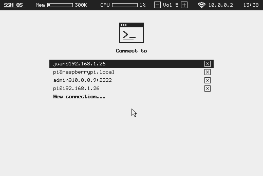
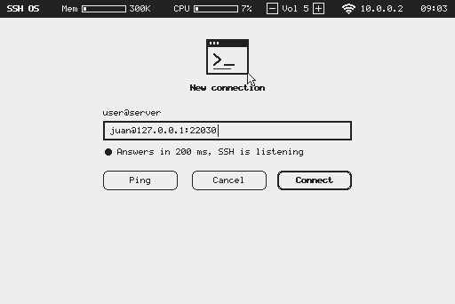
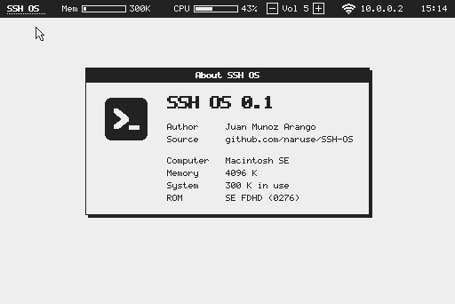
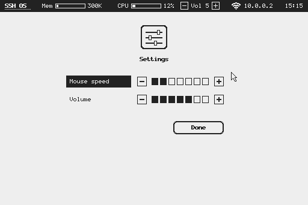
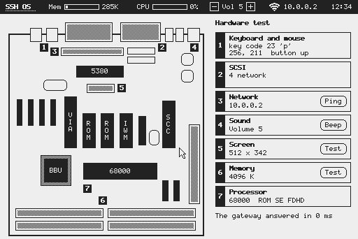
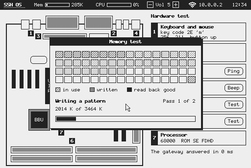
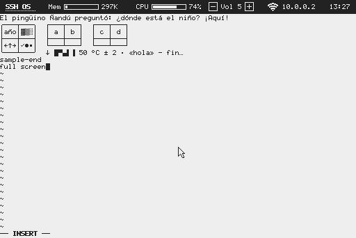

# Using SSH OS

The home screen, SSH, the terminal and the settings. Back to the
[README](../README.md).

## First start

The start-up screen shows for a few seconds, then the home screen.

1. **WiFi.** Click the fan icon on the bar (or press W). The panel lists the
   networks in range; click yours and type its password. It is remembered on
   the SSH OS disk. (A `bluescsi.ini` on the card with the BlueSCSI's own
   WiFi settings works too.)
2. **SSH.** Click the SSH icon, type `user@server`, press Return. The first
   time, the SE shows the fingerprint of the server's key and asks whether to
   trust it; then it asks for the password. Connecting takes the SE about a
   minute by itself, see [how long connecting takes](NOTES.md#how-long-connecting-takes),
   and far less with [the BlueSCSI firmware](../README.md#faster-ssh-the-bluescsi-firmware).
3. Command-Q or Control-] ends a session and returns to the home screen.
   Command with the up or down arrow is Page Up or Page Down, and with the
   left or right arrow Home or End: the SE's own keyboard has none of them.

## The home screen

| | Mouse | Keyboard |
|---|---|---|
| Open SSH, the hardware test or Settings | click its icon | Left/Right, then Return |
| SSH OS menu | click SSH OS in the bar | J, then Up/Down and Return |
| Network details, other WiFi networks | click the fan icon | W |
| Volume down and up | click the - and + on either side of Vol | - and + |
| Close a menu, panel or window | click elsewhere | Esc or any key |

The bar stays at the top in every program, and so does the mouse pointer:
the menu, the panels and the volume can be used from inside an SSH session
too. The SSH OS menu has About, Home, OSConsole (the command line; `help`
lists every command), Restart and Shut down.

**SSH** opens on the list of connections used before, newest first, with
"New connection" under them. "New connection" has a Ping button (or Tab): it says whether the
server answers and SSH is listening. Connect asks the same first, so a dead
server is reported in about 4 seconds, before the slow key work.
Up/Down and Return or a click connect. The small box with a cross at the
end of a line, or Delete, forgets that connection, and with it what the SE
kept about it: the server's fingerprint (unless another connection still
goes there) and a "no" to logging in without a password, so both are asked
again if you go back. The connection named by the setting `ssh` can be
forgotten the same way; that empties the setting.



In every text field (New connection, the password, a WiFi password) a click
or the Left and Right arrows move the caret, and typing and Delete happen
there. While it connects there is a Cancel button; Esc does the same, at any
point, the slow key steps included.







**Settings** has the mouse speed (seven steps, from half speed to six times)
and the volume. Both are kept on the SSH OS disk.



**Hardware test** draws the SE's logic board as it lies in the case, after a
photograph of one: the sockets of the back panel along the top, the memory
along the bottom. Each numbered part has a field beside it with what it
reports now (the last key, where the mouse is, what answers on the SCSI
bus) and, where there is something to try, a button: Ping, Play, Test. The
keys P, B, S and M do the same; + and - change the volume; Esc goes back.
Play plays a tune and turns into Stop while it lasts.



The memory test shows the machine's memory as 64 squares. Each fills in as
it is written and turns black as it reads back good, twice over with
opposite patterns; a square that reads back wrong keeps a cross. The
hatched squares hold SSH OS itself, its stack and the screen, and are left
alone. It takes about 15 seconds; Esc stops it.

The time comes from the Mac's own battery-backed clock, as the ROM read it at
start-up; if that battery is flat it will be wrong.

## The SSH OS disk

What is changed on the SE is kept on a hard disk of its own, so it is still
there after a restart:

| File | What |
|---|---|
| `SETTINGS.TXT` | Settings changed on the SE: `set NAME VALUE` in the OSConsole, the volume, the WiFi network joined from the panel (with its password, as plain text). They win over the ones built into the boot disk. |
| `HOSTS.TXT` | SSH servers whose key you accepted. The question comes once per server. |
| `RECENT.TXT` | The last eight SSH connections. The SSH icon opens on this list: Up/Down and Return or a click connect, Delete forgets one, "New connection" asks for another. |

Without an SSH OS disk everything works as before and lasts until restart.

To make one, give the machine a blank disk image (on the BlueSCSI's card,
for example a file of zeros named `HD1_512 SSH OS.hda` for SCSI ID 1) and in
the OSConsole type `scsi` to see its ID, then `format ID`. Or make it ready
on your computer:

```bash
python3 tools/sshosdisk.py make "HD1_512 SSH OS.hda" 16
```

The disk is a FAT16 volume named SSH OS, so the image also opens on a modern
Mac (`hdiutil attach -imagekey diskimage-class=CRawDiskImage FILE`) and the
files can be read and edited there;
`tools/sshosdisk.py` lists, reads and writes them without mounting, and
`check` goes through the whole volume. Files are in one folder, have short
names (8 characters, a dot, 3) and are read and written whole. In the
OSConsole: `disk`, `ls`, `cat NAME`, `rm NAME`.

Two rules protect your disks. SSH OS writes only to a volume named SSH OS,
and `format` refuses any disk that is not blank or an SSH OS disk already, so
a disk with a Mac system on it is never touched. And a file is replaced by
writing the new one to free space and switching over in a single block, so
switching the machine off mid-write leaves the old file or the new one.

`disk = 1` in `config.txt` names the SCSI ID and saves the second or two it
takes to look at every ID at start-up (that happens after the home screen is
up).

`start = shell` in `config.txt` starts at the command line instead; `ssh`
goes straight to connecting.

## SSH

In the OSConsole the same client is the command `ssh me@192.168.1.10`, or
just `ssh` with the address in the setting `ssh`. The SE talks to the server
directly: standard SSH, as any current OpenSSH server speaks it.

**Logging in with a key** (no password to type). Make a key just for the SE,
on your computer:

```bash
ssh-keygen -t ed25519 -N '' -C 'Macintosh SE' -f se_key
```

```bash
python3 tools/sshkey.py se_key
```

The second command prints an `ssh_key = ...` line for `config.txt`. The line
in `se_key.pub` goes into `~/.ssh/authorized_keys` on each server. The key
sits unprotected in the boot image, so treat that image and `config.txt`
like the key itself, and delete the key from `authorized_keys` if the card
gets lost.

**Logging in with a password.** Without `ssh_key`, or if the server does not
accept the key, the SE asks for the password in a small window (a dot for
each letter).

**No password next time.** After a log-in by password the SE asks whether to
log in to that account without one from now on. On yes it makes an Ed25519
key of its own (once, about 15 seconds), keeps it on the SSH OS disk
(`KEY.TXT`) and adds its public half to `~/.ssh/authorized_keys` on the
server, in a line ending in `SSH-OS`. The password is not kept anywhere. To
cut the SE off from a server, delete that line there. A no is remembered
(`NOKEY.TXT`), so it asks once for each account. Like a key in `config.txt`,
the one on the SSH OS disk is unprotected: whoever has the card has it.

This needs the SSH OS disk (the second image on the card, `HD1_512`), which
is where the key lives. Without one the SE does not offer, and asks for the
password every time. One key serves every server: forgetting a connection
on the SE does not take the key out of that server's `authorized_keys`.

**Is it the right server?** On the first connection the SE shows the
fingerprint of the server's key and asks. The answer is kept on the SSH OS
disk (`HOSTS.TXT`), so later connections do not ask, and a server that
suddenly shows a different key is refused.

**What it needs from the server:** an Ed25519 host key, the key exchange
`curve25519-sha256` and the cipher `chacha20-poly1305@openssh.com`. OpenSSH
has had all three since version 6.5 (2014). Servers limited to other choices
are refused with a message saying which is missing.

**The terminal** (`kernel/vt.c`) tells the server it is `xterm-256color` and
understands what xterm does, as far as a black-and-white screen can show it:
cursor movement, erasing, inserting and deleting, scrolling regions, the
second screen that full-screen programs switch to, bold, underline and
inverse, UTF-8, and the questions programs ask a terminal. There are no
colours: a coloured background is shown as inverse, coloured text as plain.
The font has Western European accents, line drawing, blocks and arrows;
anything else becomes the nearest of those, or `?`. The screen is 85 columns
by 32 lines. `ssh_term` in the settings changes what it calls itself.



## Typing accented letters

Option works as on a Mac with the US layout, in the OSConsole and in `ssh`:

| Keys | Result |
|---|---|
| Option-e, then a vowel | á é í ó ú |
| Option-n, then n | ñ |
| Option-u, then a vowel | ä ë ï ö ü |
| Option-`, then a vowel | à è ì ò ù |
| Option-i, then a vowel | â ê î ô û |
| Shift-Option-/ and Option-1 | ¿ ¡ |
| Option-c | ç |
| Option-\ and Shift-Option-\ | « » |

Capitals work the same way (Option-n, then N). Also there: ß å ø æ £ ¢ ¥ § ¶
© ® ° ± · µ ÷ ª º ¬ • … —, on their Mac keys.

In `ssh`, Option with any other key is the Meta key, so Option-b
and Option-f still move by a word; pressing Esc first works for every key.
`option = meta` in `config.txt` makes Option always Meta there.

## Settings file

`config.example.txt` explains every setting. The ones most used:

| Setting | What |
|---|---|
| `network` | `dhcp`, or four numbers: address, mask, gateway, name server |
| `ssh` | Where `ssh` without arguments logs in: `user@host` or `user@host:port` |
| `ssh_key` | The SE's own key, from `tools/sshkey.py` |
| `ssh_term` | What the terminal calls itself; `xterm-256color` unless set |
| `start` | What runs at start-up: `desk` (the home screen), `shell`, `ssh` |
| `disk` | The SCSI ID of the SSH OS disk, which saves looking at every ID |
| `mouse`, `volume` | 1 to 7 and 0 to 7; Settings and the bar change them |

Settings changed on the SE (`set NAME VALUE` in the OSConsole, Settings, the
WiFi panel) are written to the SSH OS disk and win over the built-in ones.

